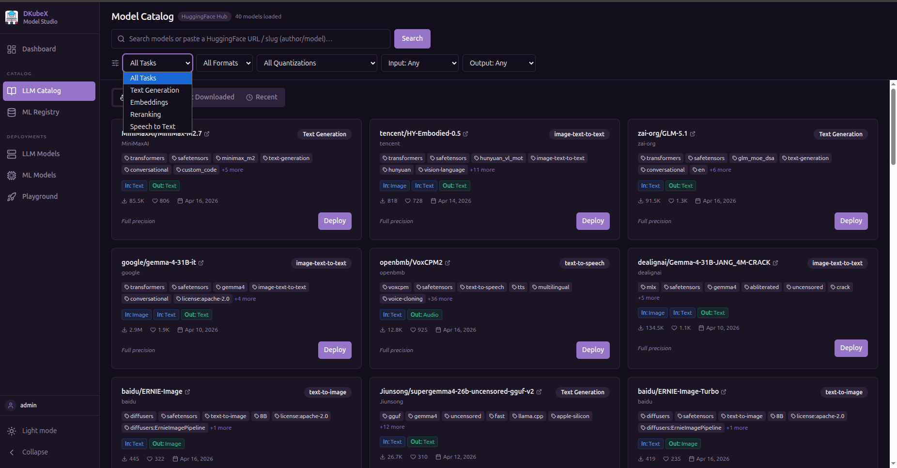
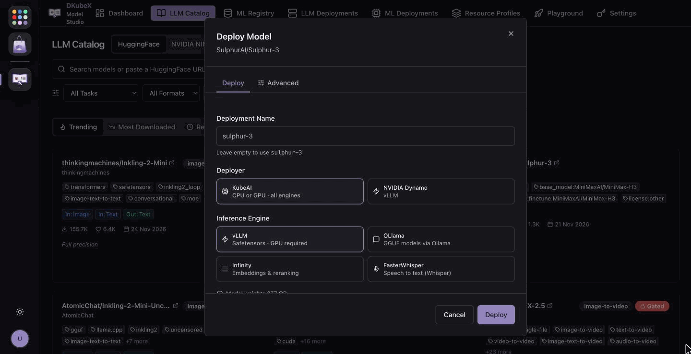
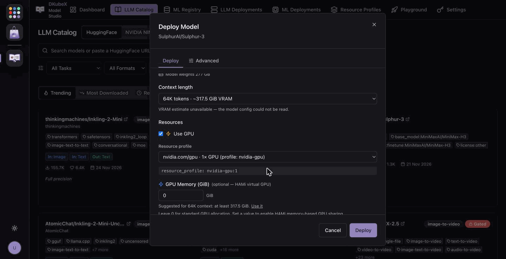
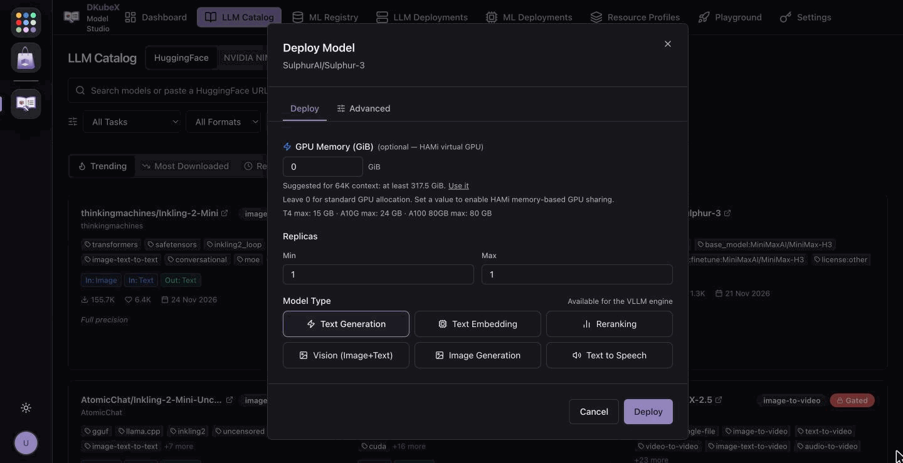
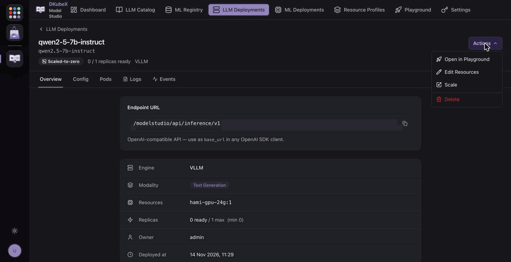
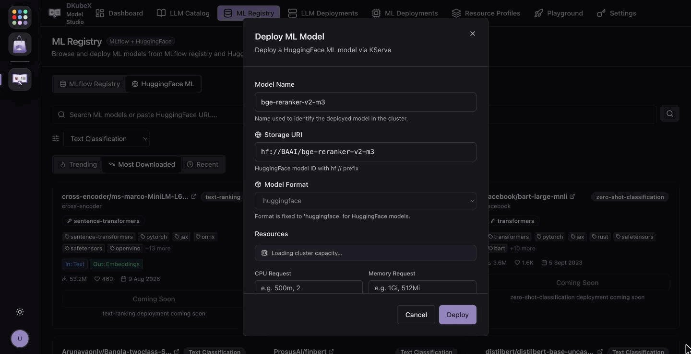

# Deploying Models

ModelStudio supports three deployment paths:

- **LLM models** — deployed with [KubeAI](https://github.com/kubeai-project/kubeai) (as `Model` CRDs) or NVIDIA Dynamo, sourced from HuggingFace Hub
- **ML models** — deployed as [KServe](https://kserve.github.io/website/) `InferenceService` CRDs, sourced from MLflow or HuggingFace Hub
- **NVIDIA NIM models** — registered from the NVIDIA NGC catalog and deployed in-cluster on GPU nodes via the k8s-nim-operator

---

## LLM models (KubeAI)

### Discovering LLM models

Use the **LLM Catalog** page. Its source tabs are **HuggingFace**, **NVIDIA NIM**, and **Local**; search HuggingFace by name or paste a HuggingFace URL / slug (`author/model`). Models are shown across four list tabs:

- **Trending** — models gaining momentum
- **Most Downloaded** — sorted by all-time download count
- **Recent** — newest additions
- **Search Results** — results for your query or HuggingFace URL/slug

You can filter by:

| Filter | Options |
|--------|---------|
| Task (**All Tasks**) | Text Generation, Embeddings, Reranking, Text to Speech *(Speech Recognition and Image Generation — coming in future KubeAI releases)* |
| Format (**All Formats**) | GGUF (quantized), Safetensors, PyTorch |
| Quantization (**All Quantizations**) | Q4_K_M, Q4_0, Q5_K_M, Q6_K, Q8_0, FP16, BF16 |
| Input modality (**Input**) | Text, Image, Audio, Video, File |
| Output modality (**Output**) | Text, Image, Audio, Embeddings, Video |



---

### The LLM deploy form

Click a model card to open its side panel, then click **Deploy** to open the **Deploy Model** form. The form has two tabs, **Deploy** and **Advanced**, and its header shows the model you chose from the LLM Catalog (for example `Qwen/Qwen2.5-0.5B-Instruct`).



#### Fields

| Field | Description | Example |
|-------|-------------|---------|
| **Deployment Name** | Name of the deployment. Leave it empty to use the name derived from the model. | `sulphur-3` |
| **Deployer** | What serves the model: **KubeAI** (*CPU or GPU · all engines*) or **NVIDIA Dynamo** (*vLLM*) | `KubeAI` |
| **Inference Engine** | Inference runtime (auto-selected based on model type): **vLLM** (*Safetensors · GPU required*), **OLlama** (*GGUF models via Ollama*), **Infinity** (*Embeddings & reranking*), or **FasterWhisper** (*Speech to text (Whisper)*) | `vLLM` |
| **Context length** | Maximum context length in tokens. Each option shows an estimate of the VRAM it needs; the form also shows the size of the model weights. | `64K tokens · ~317.5 GiB VRAM` |
| **Resources → Use GPU** | Run the model on a GPU | checked |
| **Resources → Resource profile** | CPU/GPU/memory allocation profile (see [Resource profiles](#resource-profiles)) | `nvidia-gpu` |
| **GPU Memory (GiB)** | Optional HAMi virtual GPU memory (see [Share a GPU between models](#share-a-gpu-between-models)) | `0` |
| **Replicas → Min / Max** | Minimum and maximum number of serving pods | `1` / `1` |
| **Model Type** | Inference capability to enable, available for the vLLM engine: **Text Generation**, **Text Embedding**, **Reranking**, **Vision (Image+Text)**, **Image Generation**, or **Text to Speech** | `Text Generation` |





Deployed models are visible to all users.

:::{admonition} Supported features in the current KubeAI release
:class: note
`TextGeneration`, `TextEmbedding`, `Reranking`, `TextToSpeech`. Support for `SpeechToText`, `ImageText` (Vision), and `ImageGeneration` is planned for future KubeAI releases.
:::

#### Resource profiles

The **Resource profile** list offers the bundled KubeAI profiles and your custom profiles from the **Resource Profiles** page. The list is fetched dynamically from `/api/resource-profiles` based on the nodes available in your cluster. The bundled profiles are read-only and admin-managed via Helm values; contact your cluster admin to change them.

#### Share a GPU between models

You can deploy more than one model on a single GPU. To do this, set **GPU Memory (GiB)** in the **Resources** part of the deploy form.

| GPU Memory (GiB) | What happens |
|------------------|--------------|
| `0` | The model takes the whole GPU, so only this one model can be deployed on it. |
| A value, such as `15` | The model takes 15 GiB of the GPU's total memory. The rest of the GPU's memory is left for other models on the same GPU. |

The form says: *Leave 0 for standard GPU allocation. Set a value to enable HAMi memory-based GPU sharing.* It also suggests a value for the chosen context length and lists the maximum memory of each GPU type.

---

### LLM deployment lifecycle

After you click **Deploy**, the KubeAI `Model` CRD is created. KubeAI reconciles the resource:

```
Pending → Downloading → Starting → Running
```

| Status | Meaning |
|--------|---------|
| `Pending` | CRD created, pods not yet scheduled |
| `Downloading` | Model weights being pulled from HuggingFace |
| `Starting` | Pods scheduled, inference server initializing |
| `Running` | Model ready to serve requests |
| `Failed` | Pod could not start — check cluster logs |

Monitor progress in the **Dashboard** model table or the **LLM Deployments** page.

---

### Managing deployed LLM models

All your LLM deployments are visible on the **LLM Deployments** page, with their source, deployer, engine, status, replicas, who deployed them, and when. Use the search box and the **Source** filter (**All**, **HF**, **NIM**) to narrow the list.

#### The deployment detail page

Open a deployment to see its detail page. The header shows the deployment's name, status, replicas ready, and engine, with a link back to **LLM Deployments**. The page has five tabs: **Overview**, **Config**, **Pods**, **Logs**, and **Events**.

**Overview** shows:

- **Endpoint URL** — `/modelstudio/api/inference/v1`. The page notes: *OpenAI-compatible API — use as `base_url` in any OpenAI SDK client.*
- **Engine**, **Modality**, **Resources**, **Replicas**, **Owner**, and **Deployed at**

The **Actions** menu (top right) has **Open in Playground**, **Edit Resources**, **Scale**, and **Delete**.



#### Edit a model

Click **Actions → Edit Resources** to change the resource profile and advanced settings.

To change the replica count, click **Actions → Scale**.

The update is applied via a `PATCH /api/models/{id}` call and takes effect immediately.

#### Delete a model

Click **Actions → Delete**. The KubeAI CRD is removed and all pods are terminated. This action cannot be undone.

#### Open in Playground

Click **Actions → Open in Playground** on any running model to jump directly to the inference workbench with that model pre-selected.

---

### LLM CRD naming convention

Model IDs are sanitized to be Kubernetes-safe (lowercase alphanumeric and `-`, max 63 characters). Colons, slashes, underscores, and dots in the original HuggingFace model ID are converted to `-`.

---

## ML models (KServe)

:::{note}
ML model deployment requires KServe to be enabled in the platform. The **ML Registry** and **ML Deployments** pages are hidden when KServe is not available.
:::

### Discovering ML models

Use the **ML Registry** page. It has two tabs:

- **MLflow Registry** — lists registered models from your connected MLflow model registry. Each model shows its registered versions and lifecycle stages (`None`, `Staging`, `Production`, `Archived`). Requires MLflow to be configured in the platform. All MLflow model formats (sklearn, XGBoost, LightGBM, TensorFlow, PyTorch, ONNX, MLflow pyfunc, HuggingFace) are deployable.
- **HuggingFace ML** — HuggingFace models filtered to ML-oriented task types. **Only text-based pipeline tasks are currently supported** by `kserve-huggingfaceserver`. Models with vision, audio, tabular, or multimodal pipeline tags show a **Coming Soon** badge and cannot be deployed yet.

  **Supported HuggingFace ML pipeline tasks:**
  `text-generation`, `text2text-generation`, `text-classification`, `token-classification`, `fill-mask`, `question-answering`, `summarization`, `translation`, `feature-extraction`

  **Coming Soon (not yet deployable):**
  `image-classification`, `object-detection`, `tabular-classification`, `tabular-regression`, `image-segmentation`, `audio-classification`, and other vision/audio/multimodal tasks

Click **Deploy via KServe** on any supported model card to open the ML deploy form.

---

### The ML deploy form

For a HuggingFace model the form is titled **Deploy ML Model** — *Deploy a HuggingFace ML model via KServe*.



#### Fields

| Field | Description | Example |
|-------|-------------|---------|
| **Model Name** | Name used to identify the deployed model in the cluster; auto-filled from MLflow model name or HuggingFace model ID | `my-classifier` |
| **Storage URI** | For HuggingFace models, the HuggingFace model ID with the `hf://` prefix | `hf://BAAI/bge-reranker-v2-m3` |
| **Model Format** | Framework used to train the model; fixed to `huggingface` for HuggingFace models | `sklearn`, `xgboost`, `lightgbm`, `tensorflow`, `pytorch`, `onnx`, `mlflow`, `huggingface` |
| **Source** | Where the model artifact lives | `mlflow`, `huggingface` |
| **Min Replicas** | Minimum number of serving pods | `1` |
| **Max Replicas** | Maximum pods for autoscaling | `3` |
| **CPU Request / Limit** | Pod CPU allocation; the limit is optional | `500m` / `2` |
| **Memory Request / Limit** | Pod memory allocation; the limit is optional | `512Mi` / `4Gi` |
| **GPU** | Optional GPU resource key and count | `nvidia.com/gpu: 1` |

ModelStudio automatically resolves the correct KServe runtime based on the model format:

| Format | KServe Runtime | Notes |
|--------|---------------|-------|
| `sklearn` | kserve-sklearnserver | |
| `xgboost` | kserve-xgbserver | |
| `lightgbm` | kserve-lgbserver | |
| `tensorflow` | kserve-tensorflow-serving | |
| `pytorch` | kserve-torchserve | |
| `onnx` | kserve-tritonserver | |
| `mlflow` | kserve-mlserver (pyfunc) | Auto-detects framework flavor from MLmodel file |
| `huggingface` | kserve-huggingfaceserver | Text-based pipeline tasks only; vision/audio/multimodal coming soon |

For MLflow-sourced models, leaving the format as `mlflow` enables auto-detection: the backend reads the `MLmodel` artifact file and selects the purpose-built runtime (e.g. `kserve-sklearnserver` for sklearn flavors) instead of the generic mlserver.

:::{note}
**HuggingFace ML models** are limited to text-based pipeline tasks by the current `kserve-huggingfaceserver` runtime. Attempting to deploy a vision, audio, or multimodal HuggingFace model is blocked in the UI with a **Coming Soon** indicator.
:::

---

### ML deployment lifecycle

After clicking **Deploy**, a KServe `InferenceService` CRD is created:

```
Pending → Running
         → Failed
```

| Status | Meaning |
|--------|---------|
| `Pending` | InferenceService created, model not yet loaded |
| `Running` | Model loaded and ready to serve requests |
| `Failed` | Pod could not start or model failed to load |

Monitor progress in the **ML Deployments** table.

---

### Managing deployed ML models

All your KServe deployments are visible on the **ML Deployments** page.

You can filter by format, source, status, and owner.

#### Delete a model

Click the **Delete** icon. The KServe `InferenceService` CRD is removed. You can only delete models you own.

---

### KServe InferenceService naming

Model names are truncated and sanitized to fit Kubernetes naming constraints.

---

## NVIDIA NIM models

:::{note}
NIM requires the NIM feature to be enabled in the platform. The **NVIDIA NIM** tab in the LLM Catalog is hidden when NIM is not available.
:::

### Prerequisites

- An [NGC Personal API Key](https://org.ngc.nvidia.com/setup/personal-keys) — add it as the **NVIDIA NIM** token in **Settings**
- GPU-enabled nodes and the k8s-nim-operator installed by your cluster admin. Contact your admin to confirm availability.

---

### Discovering NIM models

Go to the **LLM Catalog** page and select the **NVIDIA NIM** tab. The NIM catalog shows models available from NVIDIA NGC, organized by category:

| Category | Examples |
|----------|---------|
| LLM | LLaMA 3.1, Mistral, Gemma, Phi |
| Embedding | NV-Embed, E5-Mistral |
| Reranking | NV-RerankQA |
| Vision-Language | VILA, PaliGemma |
| Speech | Parakeet ASR |

Use the search bar to find a specific model by name.

---

### Registering a NIM model

Click **Register** on any NIM catalog card to open the registration form.

#### Fields

| Field | Description | Default |
|-------|-------------|---------|
| **Display Name** | Human-readable name shown in Playground and model lists | model id basename |
| **GPU Count** | Number of GPUs per replica | `1` |
| **Replicas** | Number of serving instances | `1` |
| **Inference Engine** *(advanced)* | `auto` (vLLM for LLMs, operator picks for non-LLMs), `vllm`, or `tensorrt_llm` | `auto` |

NIM inference runs on your cluster's GPU nodes. The NGC API Key saved as your **NVIDIA NIM** token in **Settings** is used for both NGC catalog metadata and the in-cluster image-pull secret. Click **Register** to create the registration.

---

### NIM deployment lifecycle

After registering a NIM model, the deployment goes through several phases:

```
Pending → Deploying (cache) → Deploying (service) → Running
```

| Status | Meaning | Typical Duration |
|--------|---------|-----------------|
| `Pending` | Registration created, deployment initializing | Seconds |
| `Deploying` (cache) | Model weights being downloaded to cluster storage | 10–25 min for LLM models |
| `Deploying` (service) | Inference container starting, TRT engines compiling | 2–5 min on first start |
| `Running` | Ready to serve inference requests | — |

The Playground shows a status banner and disables inference for NIM models that are not yet Running.

:::{admonition} First-time deployment
:class: note
TRT engine compilation happens on the first start and takes 2–5 minutes. Subsequent restarts on the same node are faster because compiled engines are cached.
:::

---

### Managing registered NIM models

All registered NIM models are counted on the **Dashboard** (the **NIM MODELS** card and the **NVIDIA NIM** views) and listed on the **LLM Deployments** page (**Source** filter **NIM**).

#### Available actions

| Action | Description |
|--------|-------------|
| View status | Live status with ready replica count |
| Scale replicas | Change replica count up or down (set to 0 to release GPU) |
| Restart pods | Rolling restart of inference pods |
| View logs | Tail the last N lines from the container |
| View events | Recent events from the deployment |
| Unregister | Removes registration and all cluster resources |

:::{admonition} Unregister
:class: note
Unregistering removes the inference deployment and cached model weights from the cluster. This action cannot be undone.
:::

---

### NIM model availability

Registered NIM models are visible to all authenticated workspace users, but inference is only available once the deployment reaches Running status.

All registered NIM models are workspace-wide.
