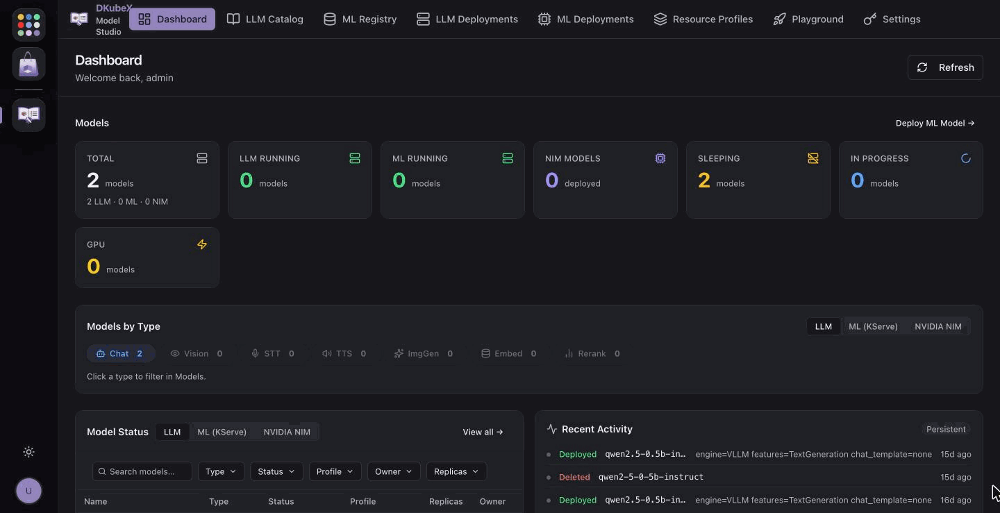
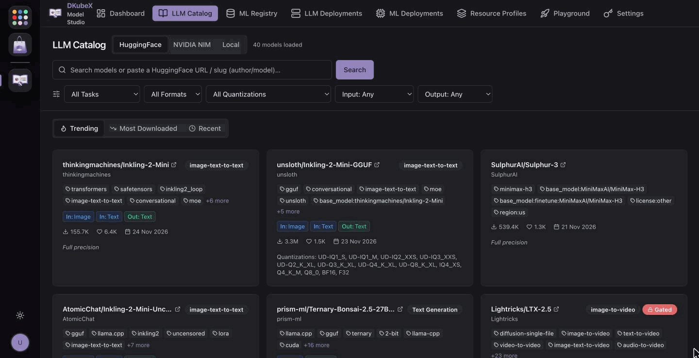
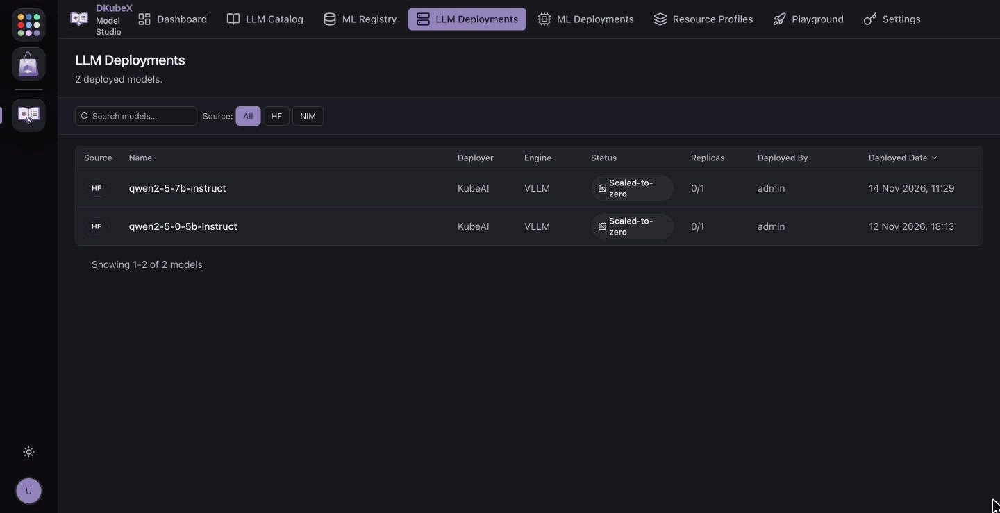
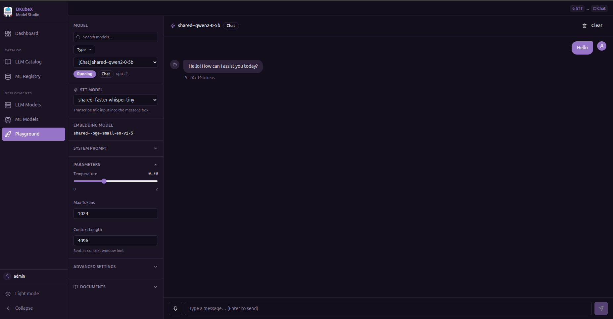
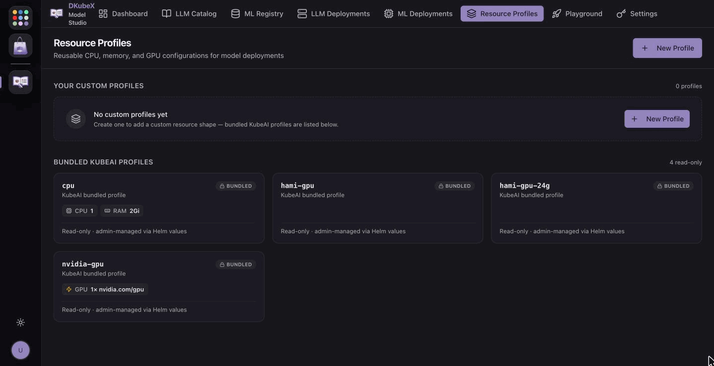
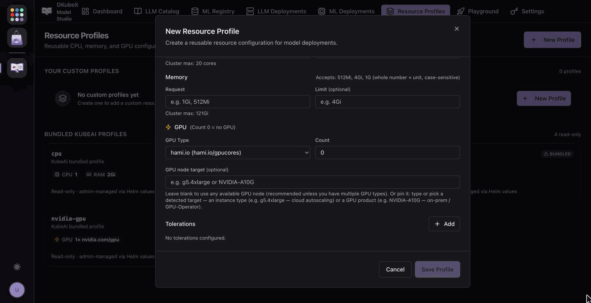
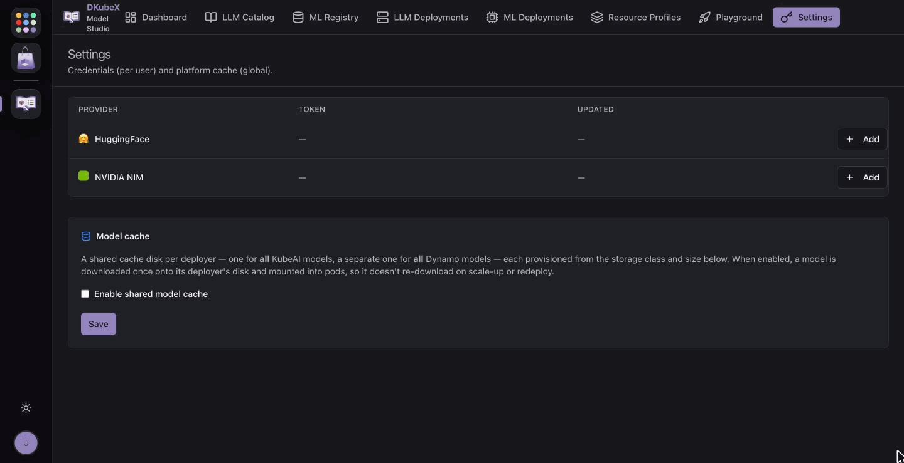

# Getting Started

ModelStudio is a web application for discovering, deploying, and running inference on AI models within the DKubeX platform. It supports three categories of models:

- **LLM models** — large language models deployed with [KubeAI](https://github.com/kubeai-project/kubeai) or NVIDIA Dynamo, sourced from [HuggingFace Hub](https://huggingface.co)
- **ML models** — traditional machine learning models (sklearn, XGBoost, PyTorch, etc.) deployed via [KServe](https://kserve.github.io/website/), sourced from an [MLflow](https://mlflow.org) registry or HuggingFace Hub
- **NVIDIA NIM models** — production-optimized inference microservices from the NVIDIA NGC catalog, deployed in-cluster on GPU nodes via the k8s-nim-operator

## What you can do

- **LLM Catalog** — Search HuggingFace LLM models and deploy them with one click
- **LLM Deployments** — View your deployed LLM models, then open one to edit its resources, scale it, or delete it
- **ML Registry** — Browse registered MLflow models or HuggingFace ML models and deploy them to KServe
- **ML Deployments** — View and delete your deployed KServe InferenceServices
- **NVIDIA NIM** (a tab of the LLM Catalog) — Discover NVIDIA NIM models and deploy them in-cluster on your GPU nodes
- **Resource Profiles** — Create and manage reusable CPU/memory/GPU configurations for model deployments
- **Settings** — Manage your HuggingFace and NVIDIA NIM (NGC API key) tokens, and the shared model cache
- **Run Inference** — Chat with models, upload documents for RAG, test vision/embeddings/reranking/image-gen/speech features
- **Track Activity** — See a log of all deploy/undeploy actions across your workspace

---

## Overview: the pages

### Dashboard

The landing page greets you (**Welcome back, <user>**), has a **Refresh** button, and shows a summary of your models:

- **Models** — cards for **TOTAL**, **LLM RUNNING**, **ML RUNNING**, **NIM MODELS**, **SLEEPING**, **IN PROGRESS**, and **GPU** models, plus a **Deploy ML Model →** link
- **Models by Type** — switch between **LLM**, **ML (KServe)**, and **NVIDIA NIM**; chips show the count for each type (Chat, Vision, STT, TTS, ImgGen, Embed, Rerank). Click a type to filter in Models.
- **Model Status** — a table of deployed models with **LLM**, **ML (KServe)** (when KServe is enabled), and **NVIDIA NIM** views; columns Name, Type, Status, Profile, Replicas, and Owner; a search box and filters for type, status, profile, owner, and replicas; **View all →** opens the full list
- **Recent Activity** — timestamped log of recent actions (deploys, deletes)

---

### LLM Catalog

Browse models and deploy LLM models directly. The page has three source tabs — **HuggingFace**, **NVIDIA NIM**, and **Local** — and a search box: **Search models or paste a HuggingFace URL / slug (author/model)**.

**List tabs:**
- **Trending** — models gaining momentum on HuggingFace
- **Most Downloaded** — sorted by all-time download count
- **Recent** — newest models
- **Search Results** — results for your search query or HuggingFace URL/slug

**Filters:**
| Filter | Options |
|--------|---------|
| Task (**All Tasks**) | Text Generation, Embeddings, Reranking, Text to Speech *(Speech Recognition and Image Generation — coming in future KubeAI releases)* |
| Format (**All Formats**) | GGUF, Safetensors, PyTorch |
| Quantization (**All Quantizations**) | Q4_K_M, Q4_0, Q5_K_M, Q6_K, Q8_0, FP16, BF16 |
| Input modality (**Input**) | Text, Image, Audio, Video, File |
| Output modality (**Output**) | Text, Image, Audio, Embeddings, Video |

Each model card shows the model's tags, task type, input and output modality (**In** / **Out**), downloads, likes, and date; gated models carry a **Gated** badge. Click a card to open its side panel (**Info**, **Model Config**, **Gen Config**), then click **Deploy** to open the deployment form.

:::{note}
Filtering by modality or task for unsupported model types (Vision, Image Generation, STT) will show models in **LLM Catalog**, but KubeAI cannot yet serve them. Support is planned for future releases.
:::

---

### LLM Deployments

A table of all deployed LLM models, headed by the count (**N deployed models.**), with a search box and a **Source** filter (**All**, **HF**, **NIM**).

**Columns:** Source · Name · Deployer · Engine · Status · Replicas · Deployed By · Deployed Date

Open a deployment to see its detail page, where the **Actions** menu has:

| Action | Description |
|--------|-------------|
| Open in Playground | Jump straight to inference for this model |
| Edit Resources | Change the resource profile and advanced settings |
| Scale | Change the replica count |
| Delete | Remove the model deployment |

See [The deployment detail page](./deploying-models.md#the-deployment-detail-page) for its tabs.

---

### Playground

A unified inference workbench for testing your deployed LLM models.

**Currently supported model types in KubeAI:**

| Tab | Description |
|-----|-------------|
| **Chat** | Stream text responses from a deployed model |
| **RAG** | Upload documents (PDF, DOCX, TXT), retrieve relevant chunks, and ground chat responses |
| **Embeddings** | Generate vector embeddings for a piece of text |
| **Reranking** | Rerank a list of passages by relevance to a query |
| **Text to Speech** | Synthesize speech from text |

Token usage (prompt, completion, total) is shown after each response. Responses can be copied to the clipboard.

:::{admonition} Coming in future KubeAI releases
:class: note
Vision (image + text), Image Generation, and Speech to Text will be supported once the corresponding KubeAI model types become available.
:::

---

### ML Registry

Browse and deploy ML models (non-LLM) from the MLflow registry and HuggingFace Hub. Only visible when KServe is enabled in the platform.

**Tabs:**
- **MLflow Registry** — registered models from your MLflow model registry, including all versions and lifecycle stages (None, Staging, Production, Archived). Requires MLflow to be configured in the platform. All model formats (sklearn, XGBoost, LightGBM, TensorFlow, PyTorch, ONNX, MLflow pyfunc, HuggingFace) are deployable.
- **HuggingFace ML** — HuggingFace models filtered to ML task types. Only **text-based pipeline tasks** are supported by `kserve-huggingfaceserver`. Models with vision, audio, tabular, or multimodal pipeline tags show a **Coming Soon** badge and cannot be deployed until the runtime adds support.

Click **Deploy via KServe** on any supported model card to open the ML deploy form and create a KServe InferenceService.

---

### ML Deployments

A table of all your deployed KServe InferenceServices (**N models deployed via KServe**), with a search box. Only visible when KServe is enabled. With nothing deployed, the page reads: *Visit the ML Registry tab to browse and deploy ML models from MLflow or HuggingFace.*

**Filters:** format (sklearn, XGBoost, MLflow, HuggingFace, ONNX, PyTorch, TensorFlow), source, status, owner

**Actions:** view status, delete deployment

---

### Resource Profiles

Reusable CPU, memory, and GPU configurations for model deployments. The page lists two kinds of profile:

- **Your custom profiles** — profiles created with **New Profile**. You can create, edit, and delete them, and load them into the deploy forms as shortcuts.
- **Bundled KubeAI profiles** — the profiles that come with KubeAI (for example `cpu`, `hami-gpu`, `hami-gpu-24g`, and `nvidia-gpu`). They are read-only and admin-managed via Helm values.

:::{note}
**Requires the database feature.** Resource Profiles are stored in the configured PostgreSQL database. If the database is not enabled, the page shows a banner with setup instructions.
:::

The **New Resource Profile** form captures:
- **Profile Name** (required) and an optional **Description**
- **CPU** request and optional limit
- **Memory** request and optional limit
- **GPU** type and count (count `0` = no GPU)
- **GPU node target** (optional) — leave it blank to use any available GPU node (recommended unless you have multiple GPU types), or pin an instance type (for example `g5.4xlarge`, for cloud autoscaling) or a GPU product (for example `NVIDIA-A10G`, on-prem / GPU Operator)
- **Tolerations** — click **Add** for each one

Click **Save Profile** to create it.

:::{note}
Each deployment keeps its own copy of the profile it was deployed with. Changes to a profile apply to new deployments, and to an existing one the next time its resources are edited.
:::

Once created, your custom profiles appear in the **Resource profile** list under **Resources** in the LLM deploy form, next to the bundled profiles, and in the **Preset** list under **Resources** in the ML deploy form. Selecting a profile in the ML deploy form pre-fills the resource fields — fields remain editable after loading.

Profiles are workspace-wide: all users can see, load, edit, and delete any profile.

---

### Settings

**Credentials (per user) and platform cache (global).**

**Credentials.** A table of providers — **HuggingFace** and **NVIDIA NIM** — with each one's **Token** and when it was **Updated**. The tokens are yours alone: each user adds their own.

- The **NVIDIA NIM** token is your NGC API key: the credential needed to access the NVIDIA NGC catalog and inference APIs for NIM models.
- **Add a key** — click **Add** on the provider's row and paste the token; it is stored securely and only shown as a masked hint (for example `nvapi-****xxxx`)
- **Delete a key** — removes the saved credential; existing NIM registrations that reference it will stop working

**Model cache.** A shared cache disk per deployer — one for all KubeAI models, a separate one for all Dynamo models. When **Enable shared model cache** is on, a model is downloaded once onto its deployer's disk and mounted into pods, so it doesn't re-download on scale-up or redeploy. Click **Save** to apply the change. The model cache is a global setting.

---

## Next steps

- [Workflows](./tutorials.md) — deploy your first LLM, ML, and NVIDIA NIM model, step by step
- [Deploying Models](./deploying-models.md) — advanced deployment options for both LLM and ML models
- [Playground Guide](./playground.md) — detailed walkthrough of each inference mode
