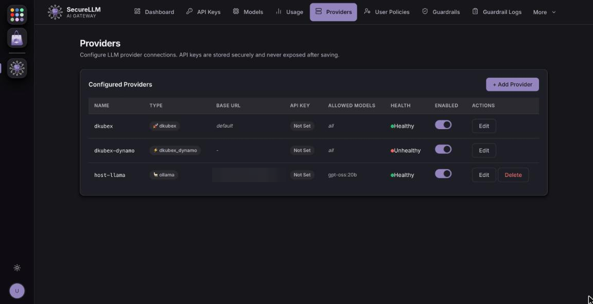
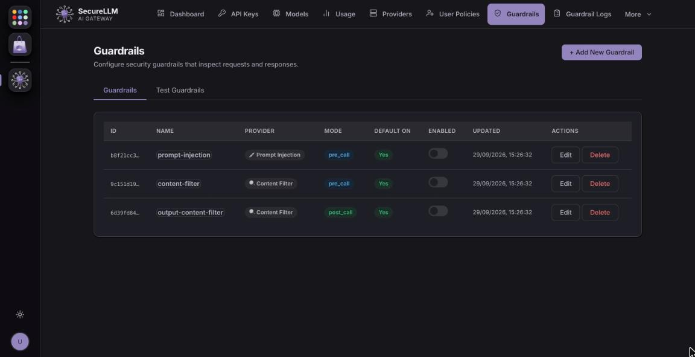

# Administrator Features

:::{note}
Admin pages are only visible if your account has been granted admin access. Contact your SecureLLM administrator if you believe you should have admin rights.
:::

Admins see all four user pages (with organization-wide data) plus seven additional pages: **Providers**, **User Policies**, **Guardrails**, and **Guardrail Logs** in the top menu, and **Audit Logs**, **Performance**, and **Settings** under **More**.

## Dashboard (admin view)

Identical to the user dashboard, but all numbers reflect the **entire organization** — every user's requests, tokens, and costs ("Overview of API usage across all users"). Use this to monitor overall AI spend and identify which teams or models drive the most usage.

## API Keys (admin view)

The **API Keys** page ("Manage all API keys") lists every key in the organization.

- The **Create New Key** card has, besides **Key Name** and **+ Create Key**, the **Allowed Providers** and **Allowed Models** pickers.
- The **All Keys** table shows each key's **Prefix**, **Name**, **Owner**, **Uses**, **Last Used**, **Created**, **Providers**, and **Allowed Models**, with **Edit** and **Revoke** buttons.

## Usage Logs (admin view)

The **Usage** menu item opens the **Usage Logs** page. For admins it shows the organization-wide request history ("Organisation-wide request history") with the number of records.

- Cards at the top show **Total Requests**, **Success Rate**, **Avg Latency**, and **Guardrails Fired** (blocked · modified · flagged).
- Filter by **Provider**, **App**, **Status**, **Guardrails**, **User**, or **Date**, or type a model, key, or user in **Search**.

## Providers

Providers are the AI services SecureLLM connects to (e.g., OpenAI, Anthropic, or your organization's own AI deployment). The **Providers** page ("Configure LLM provider connections. API keys are stored securely and never exposed after saving.") lists them in the **Configured Providers** table, with each provider's **Name**, **Type**, **Base URL**, **API Key**, **Allowed Models**, **Health** (Healthy or Unhealthy), an **Enabled** toggle, and **Edit** and **Delete** actions.

**Adding a provider:**

1. Click **Providers** → **+ Add Provider**.
2. Select the provider type from the dropdown.
3. Enter the provider's **API Key** and, if needed, a custom **Base URL**.
4. Optionally list **Allowed Models** (leave blank to allow all models from this provider).
5. Click **Save**.

**Enabling / disabling a provider:**

Use the **Enabled** toggle in the provider's row. Disabling pauses routing to that provider without losing its configuration — useful for maintenance or cost control. Only delete a provider when you are certain it will never be used again.

## User Policies

The **User Policies** menu item opens the **User Restrictions** page ("Manage allowed providers and models per user."), where you set access policies for individual users — controlling which providers and models each person can use.

**Adding a restriction:**

1. Click **User Policies** → **+ Add Restriction**.
2. Enter the user's email or username.
3. Specify **Allowed Providers** and/or **Allowed Models** (comma-separated).
4. Click **Save**.

**Setting a spend limit:**

In the same form, enter a **Spend Limit (USD)** and choose how often it **Resets** (never, daily, weekly, every 30 days or monthly). The limit covers the cost of all requests made with the user's API keys. Once the user's spend in the current period reaches the limit, their chat, completion and embedding requests are rejected with a `400` "budget exceeded" error until the period resets, or until you raise the limit or tick **Reset spend to $0 now**. A request that starts under the limit is allowed to finish, so spend can end slightly above it. Leave the field empty for no limit.

To remove all restrictions and the spend limit from a user (giving them full access), click **Remove** next to their policy.

## Guardrails

Guardrails are automatic safety filters that inspect AI requests and responses before they reach the AI or your users. The **Guardrails** page ("Configure security guardrails that inspect requests and responses.") has two tabs, **Guardrails** and **Test Guardrails**, and a **+ Add New Guardrail** button.

The **Guardrails** tab lists each guardrail's **ID**, **Name**, **Provider** (the guardrail type), **Mode** (`pre_call` checks the request, `post_call` the response), **Default On**, an **Enabled** toggle, **Updated**, and **Edit** and **Delete** actions. Three guardrails are listed out of the box: `prompt-injection` (Prompt Injection, `pre_call`), `content-filter` (Content Filter, `pre_call`), and `output-content-filter` (Content Filter, `post_call`).

**Three guardrail types:**

| Type | What it does |
|---|---|
| **Content Filter** | Blocks or masks sensitive content — credit card numbers, passwords, PII (names, phone numbers, etc.) |
| **Prompt Injection** | Detects attempts to manipulate the AI into ignoring its instructions (jailbreak attempts) |
| **Custom** | Advanced: accepts a raw JSON configuration for organization-specific rules |

**Enabling or disabling a guardrail:** Use the **Enabled** toggle in the guardrail's row. Changes take effect immediately for all new requests.

**Testing a guardrail:**

1. Click the **Test Guardrails** tab.
2. Select one or more guardrails to test.
3. Paste sample text into the input box.
4. Click **Run Test**.
5. Results show whether the guardrail triggered, what action it took (block / mask / warn), and how long it took to run.

## Guardrail Logs

Every time a guardrail evaluates a request, it writes a log entry here ("Real-time log of every guardrail execution across all API requests."). Until a guardrail runs, the page shows "No guardrail events".

- Filter by **Guardrail Name** or **Triggered** status (triggered / not triggered), or use **Search**. **Clear** resets the filters.
- The summary bar shows total events, how many triggered, and the overall pass rate.
- Click any row to see the exact text that was flagged and the action taken.

Use this page to verify that your guardrails are catching what they should — and not over-blocking legitimate requests.

## Audit Logs

Audit Logs (under **More**) record every administrative action taken in SecureLLM: who created or revoked a key, who changed a provider, who updated a user policy — with timestamps and IP addresses.

- Filter by **actor** (admin's email) or **action type** (e.g., `create_key`, `revoke_key`, `update_provider`).
- Use this page for compliance reviews or to investigate unexpected changes.

## Performance

The Performance page (under **More**) shows how the gateway itself is behaving.

- **Uptime** — how long SecureLLM has been running since last restart
- **Total Requests / 5xx Errors** — overall traffic and error counts
- **Latency by Endpoint** — P50, P95, and P99 response times per API endpoint

:::{tip}
P95 latency is the response time that 95% of requests fall under. A spike here usually means a specific provider is slow, not that SecureLLM itself is the bottleneck.
:::

## Settings

The **Settings** page (under **More**) sets the "Retention for usage-log payloads and records."

**Log payload storage:** "The full request and response of every call is stored as JSON files on the log volume. When the volume fills past the threshold, the oldest files are deleted until the cleanup amount has been freed. The table rows remain, showing their preview only."

- The page shows the volume's **Used** space, **Capacity**, number of **Files**, **Last cleanup**, and **Location**.
- **Cleanup threshold (% of capacity)** — how full the volume can get before the oldest files are deleted.
- **Space to free (% of capacity)** — how much space each cleanup frees.

**Database retention:** "Only the newest usage records are kept. Older records are deleted together with their payload files."

- The page shows the number of **Records** and the **Last prune**.
- **Maximum records to keep** — the number of newest usage records kept.
